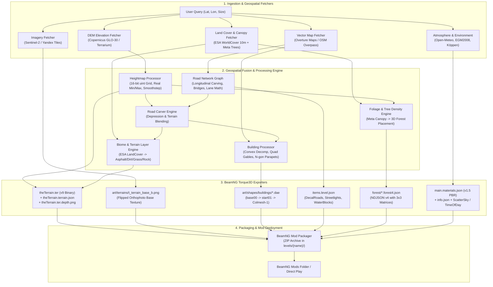

# AroundWorldNG: Генератор Реального Мира для BeamNG.drive
## Генеральный архитектурный манифест, спецификация источников данных и дорожная карта (Master Blueprint)

---

## 1. Концепция и видение проекта (Project Vision)

**AroundWorldNG** — это модульный процедурный генератор карт и окружения реального мира для автосимулятора **BeamNG.drive** (движок Torque3D v9 / PBR 1.5).

### Главная цель
Позволить игроку указать **любую точку на планете Земля** (координаты, город, гоночный трек, горный серпантин или сельскую местность), задать размер территории ($1\times1$, $2\times2$, $4\times4$ км) и в один клик получить полноценный, физически корректный мод-уровень для BeamNG.drive с:
1. **Точным рельефом** (без сплющивания, артефактов и «зыбучих песков»).
2. **Реалистичной фотоподложкой** (ортофотоснимки высокого разрешения, совмещенные с микро-детализацией PBR).
3. **Настоящей дорожной сетью** (с правильным количеством полос, разметкой, мостами, тоннелями и гладкими перекрестками).
4. **Умной архитектурой зданий** (L-, U-образные дома, многоэтажки, коттеджи с честной физической коллизией).
5. **Аутентичными биомами** (леса, поля, кустарники, водоемы, береговые линии, привязанные к глобальным картам растительности и спутниковой классификации почв).
6. **Реальной физической атмосферой** (погода, угол солнца, гравитация и климатическая зона).

---

## 2. Спецификация источников данных (The Complete Real-World Data Stack)

На основе передового мирового опыта процедурной генерации геоданных (включая архитектуру EarthNG, Microsoft Flight Simulator и открытые научные спутниковые группировки), генератор опирается на следующий стек источников:

```
+----------------------------------------------------------------------------------------------------+
|                                      AROUNDWORLDNG DATA STACK                                      |
+--------------------------+-------------------------------------------------------------------------+
| Слой данных              | Первичный / Рекомендуемый источник                                      |
+--------------------------+-------------------------------------------------------------------------+
| 1. Спутниковые снимки    | EOX Sentinel-2 Cloudless (глобально) + Яндекс/Bing/Google (городской зум)|
| 2. Рельеф и высоты (DEM) | Mapterhorn / AWS Terrarium (Copernicus DEM GLO-30 + SRTM 30m)           |
| 3. Векторные карты       | Overture Maps Foundation (GeoParquet) + OpenStreetMap (OSM)            |
| 4. Здания и контуры      | Microsoft Building Footprints + Overture Buildings + OSM Buildings     |
| 5. Классификация почв    | ESA WorldCover (10m глобальная классификация земного покрова)           |
| 6. Леса и плотность крон | Meta & WRI High-Resolution Canopy Height (1m/10m плотность и высота крон)|
| 7. Батиметрия (глубины)  | NOAA NCEI Global Relief Model (глубины рек, озер, морей)                |
| 8. Погода и атмосфера    | Open-Meteo Historical / Real-Time API (облачность, туман, солнце)      |
| 9. Гравитация            | NGA EGM2008 (Earth Gravitational Model)                                 |
| 10. Климатическая зона   | Beck et al. (Köppen-Geiger Climate Classification)                      |
+--------------------------+-------------------------------------------------------------------------+
```

### Детальное назначение каждого источника:

#### 1. Спутниковые ортофотоснимки (Imagery)
- **EOX Sentinel-2 Cloudless (2023 & 2016)**: Глобальная безоблачная спутниковая мозаика Европейского космического агентства (Copernicus). Идеальна для базовой подложки ландшафта, загородных территорий, полей и гор (отсутствуют облака, тени и швы склейки).
- **Яндекс.Карты / Bing Maps Aerial (High-Zoom 17–19)**: Используются для локальной урбанистической детализации (0.3–0.5 м/пиксель) в городах России/СНГ и мира: дорожная разметка, асфальт дворов, парковки, текстуры крыш.
- **Интеграция в движок:** Снимок сохраняется как `art/terrains/t_terrain_base_b.png` с вертикальным отражением (South $\to$ North) и проецируется через `baseColorBaseTex` шейдера BeamNG с мягким смешиванием микро-текстур травы и гравия.

#### 2. Цифровая модель рельефа (Elevation / DEM)
- **Mapterhorn / AWS Terrarium**: Тайлы высот Web Mercator в кодировке Terrarium RGB:
  $$\text{Elevation (meters)} = (R \times 256 + G + B / 256) - 32768$$
- Базируется на **Copernicus DEM 30m (GLO-30)** и SRTM. Дает непрерывную топографическую сетку высот без пропусков.

#### 3. Векторные дороги и сети (Map / Roads)
- **Overture Maps Foundation (Transportation Theme)**: Мировой золотой стандарт векторных дорог, объединяющий данные TomTom, Meta, Microsoft и OSM. Содержит строгую типизацию полос, разделителей, ограничений скорости и классы дорожного покрытия.
- **OpenStreetMap (OSM Overpass)**: Локальные атрибуты: разметка, тротуары, мосты (`bridge=yes`), тоннели (`tunnel=yes`), типы покрытий (`surface=asphalt/cobblestone/dirt`).

#### 4. Здания и полигоны застройки (Buildings)
- **Microsoft Building Footprints**: Нейросетевые контуры сотен миллионов зданий с высокой геометрической четкостью и прямоугольностью углов.
- **Overture / OSM Buildings**: Атрибуты высотности: `building:levels`, `height`, форма крыши (`roof:shape=gabled/flat/hipped`), цвет фасада.

#### 5. Земной покров и грунты (Land Cover: ESA WorldCover 10m)
- Глобальная растровая карта классификации поверхности с разрешением 10 метров:
  - `10: Tree cover` (лес, тайга, лиственные массивы)
  - `20: Shrubland` (кустарники, вереск, тундра)
  - `30: Grassland` (трава, луга, газоны)
  - `40: Cropland` (сельхозугодья, пашни)
  - `50: Built-up` (городская застройка, асфальт, бетон)
  - `60: Bare / sparse vegetation` (песок, скалы, гравий, карьеры)
  - `80: Permanent water bodies` (озера, реки, водохранилища)
- **Роль в генераторе:** Автоматически красит `layerMap` террейна BeamNG в правильные материалы (где песок — там песок, где скалы — скалы, где луг — трава), исключая монотонный зелёный мир.

#### 6. Деревья и плотность крон (Trees: Meta & WRI)
- Глобальная карта высоты крон деревьев (Canopy Height Model) от Meta AI и World Resources Institute.
- Позволяет спавнить не случайные деревья по сетке, а **точные 3D-модели деревьев реальной высоты** (например, дубы 18м или сосны 25м) именно там, где физически растет лес.

#### 7. Батиметрия и глубина водоемов (Sea Depth: NOAA NCEI)
- Глобальная батиметрическая сетка глубин морей, заливов и крупных рек. Предотвращает висячие над бездной реки и задает точное дно для физического плавания автомобилей.

#### 8. Атмосфера, климат и физика (Weather, Gravity, Climate)
- **Open-Meteo**: Задает реальное положение солнца (`azimuth`, `elevation`), облачность, туман, освещенность неба (`ScatterSky`) в зависимости от времени суток и сезона.
- **NGA EGM2008**: Реальная локальная гравитация (например, $9.816$ м/с² в Мурманске против $9.780$ м/с² на экваторе).
- **Köppen-Geiger Climate**: Автоматический выбор палитры растительности (средиземноморские кипарисы/пальмы, европейские дубы/березы, скандинавские ели).

---

## 3. Спецификация движка BeamNG.drive (Torque3D Engine Rules & Hard Limits)

В процессе исследования и реверс-инжиниринга исходного кода BeamNG.drive (`tsShapeLoader.cpp`, `tsCollision.cpp`, `terrainBlock.cpp`, `daeExport.lua`, `forest4.json`) были доказаны следующие критические правила:

### А. Физический рельеф (TerrainBlock & `theTerrain.ter`)
1. **Путь к файлу террейна:**
   - В `items.level.json` путь **ОБЯЗАН** начинаться со слэша: `"/levels/{level_name}/theTerrain.ter"`.
   - Без начального слэша VFS BeamNG не может загрузить `.ter`, физический коллайдер не регистрируется, и автомобиль проваливается в пустоту («зыбучие пески»).
2. **Параметр `"maxHeight"`:**
   - `"maxHeight"` в `items.level.json` — это **ВЕРТИКАЛЬНЫЙ РАЗМАХ В МЕТРАХ** ($Z_{max} - Z_{min}$), например `150.0`.
   - **Категорически запрещено** передавать туда масштаб квантования `span / 65535` ($0.000153$)! При передаче микро-масштаба рельеф сплющивается до $0.1$ мм и карта становится столом.
3. **Формат бинарника `.ter` (Version 9):**
   - Бинарный заголовок: `version = 9 (uint8)`, `size = N (uint32, степень двойки: 512, 1024, 2048, 4096)`.
   - Данные высот: `uint16` ($N \times N$), отсортированные по строкам снизу вверх (South $\to$ North).
   - Слой материалов `layerMap`: `uint8` ($N \times N$), индексы активных PBR-слоев (Grass, Asphalt, Dirt, Rock).
   - Слой текстурного шума `layerTextureMap`: `uint8` ($N \times N$).
   - Таблица материалов `materials`: список нуль-терминированных ASCII-строк.
4. **Карта глубины жидкости (`theTerrain.ter.depth.png`):**
   - Должна быть 8-битной PNG с размером $N \times N$.
   - Значение **255** означает нулевую глубину грязи (100% твердый монолитный грунт). Значение **0** превращает поверхность в топь.

### Б. Физическая коллизия зданий (Collada DAE 1.4.1)
1. **Иерархия узлов Torque3D:**
   Движок распознает коллизию TSStatic только при наличии строгой иерархии в `<visual_scene id="Scene">`:
   ```xml
   <visual_scene id="Scene" name="Scene">
     <node id="base00" name="base00" type="NODE">
       <node id="start01" name="start01" type="NODE">
         <!-- Визуальный меш -->
         <node id="BuildingNode" name="BuildingNode" type="NODE">
           <instance_geometry url="#Visual-mesh">...</instance_geometry>
         </node>
         <!-- Коллизионный меш (строгое имя Colmesh-1) -->
         <node id="Colmesh-1" name="Colmesh-1" type="NODE">
           <instance_geometry url="#Colmesh-mesh"/>
         </node>
       </node>
     </node>
   </visual_scene>
   ```
2. **Свойства TSStatic в `items.level.json`:**
   ```json
   "collisionType": "Collision Mesh",
   "decalType": "Collision Mesh",
   "prebuildCollisionData": true
   ```
   Свойство `"Visible Mesh"` в современном BeamNG не работает для процедурных секторов.

### В. Геометрия зданий и устранение искажений
1. **Форма крыш:**
   - Скатные/двускатные крыши со щипцами (`pitched/gabled`) допустимы **только для выпуклых 4-угольников** (`N == 4 and is_convex_quad`).
   - Для всех L-, U-, T-образных контуров и многоугольников $N > 4$ центроид `(cx, cy)` лежит вне тела здания (во дворе или в воздухе). Для них **строго строится плоская крыша с триангуляцией и парапетом высотой 0.35 м**.
2. **Основание и уклон рельефа:**
   - Высота установки сектора `base_z = (z_min + z_max) / 2.0`.
   - Фундаментная юбка заглубляется на `z_min - 0.5 м`. Это исключает 3-метровые слепые цоколи на уклонах и не оставляет дыр под полом.

### Г. Растительность и деревья (Forest System)
1. **Формат BeamNG 0.24+ / 0.3x+ (NDJSON v4):**
   - Движок сканирует папку `levels/{level}/forest/` и загружает файлы:
     `forest/{tree_type}.forest4.json`
   - Каждая строка — независимый JSON-объект:
     ```json
     {"pos": [x, y, z], "rotationMatrix": [r11, r12, r13, r21, r22, r23, r31, r32, r33], "scale": 1.1, "ctxid": 0}
     ```
   - Запись в старый общий файл `{level}.forest.json` приводит к игнорированию леса движком и полному отсутствию коллизии со стволами (`ForestCell::buildPhysicsRep` не вызывается).
2. **Ассеты ядра BeamNG:**
   - Пути к мешам должны быть относительными (без ведущего слэша): `assets/meshes/foliage/trees_library/...`.
   - Несуществующие модели (`tree_beech_large_a.dae`, `tree_cypress_a.dae`) исключены; используются подтвержденные модели ядра: `tree_beech_large_b.dae`, `tree_oak_large_a.dae`, `tree_aspen_large_a.dae`, `cork_oak_bush_large.dae`.

### Д. Дорожная сеть и разметка
1. **Ширина и полосность:**
   - Ширина полотна вычисляется из тегов OSM/Overture: `width` либо `lanes * 3.5 м`.
2. **Разметка полос:**
   - Разделители полос для $lanes \ge 2$ наносятся как дочерние `DecalRoad` со смещением от центра: `offset = -half_w + i * lane_w`.
   - Материал: `line_white`, `textureLength: 8.0`, `renderPriority: 22`, `overObjects: true`, `drivability: -1` (чтобы навигационный ИИ не считал разметку отдельной дорогой).
3. **Мосты (`bridge=yes`):**
   - Настил моста интерполируется между опорными точками на берегах рек и ущелий, предотвращая проваливание дорожного полотна в дно русла.

---

## 4. Целевая архитектура генератора нового поколения (Target System Architecture)



---

## 5. Структура проекта для нового старта (Clean Project Layout)

```
aroundworldng/
├── core/
│   ├── __init__.py
│   ├── config.py             # Настройки генератора, пути ресурсов, dataclass MapConfig
│   └── projection.py         # WGS84, эллиптический Меркатор Яндекса, Web Mercator, метрическая сетка
├── fetchers/
│   ├── __init__.py
│   ├── elevation.py          # Загрузка DEM (Terrarium/Copernicus) с надежным retry/fallback
│   ├── imagery.py            # Загрузка EOX Sentinel-2 + Яндекс/Bing ортофото
│   ├── overture_osm.py       # Загрузка Overture GeoParquet + OSM Overpass (дороги, здания, вода)
│   ├── landcover.py          # Загрузка ESA WorldCover 10m (типы почв)
│   ├── canopy.py             # Загрузка Meta Canopy Height (реальная высота деревьев)
│   └── environment.py        # Open-Meteo погода, солнце, гравитация EGM2008
├── processing/
│   ├── __init__.py
│   ├── heightmap.py          # Построение 16-бит карты высот, расчет span/maxHeight
│   ├── road_graph.py         # Топология дорог, сглаживание уклонов, расчет полос и перекрестков
│   ├── road_carver.py        # Вдавливание дорожного полотна в рельеф (press margin)
│   ├── building_mesh.py      # Процедурная экструзия зданий, проверка выпуклости quads, парапеты
│   ├── exclusion.py          # Клиппинг зданий (shapely.difference) и буфер пропсов
│   └── terrain_layers.py     # Растеризация ESA WorldCover в uint8 layerMap для .ter
├── exporter/
│   ├── __init__.py
│   ├── level_builder.py      # Сборка уровня: items.level.json, terrainFile, PBR 1.5 materials
│   ├── terrain_binary.py     # Чистый генератор бинарника theTerrain.ter v9
│   ├── decal_roads.py        # Экспорт DecalRoad для дорог и разметки (Liang-Barsky clipping)
│   ├── forest_builder.py     # Экспорт forest/*.forest4.json (NDJSON v4)
│   ├── water_builder.py      # Экспорт WaterBlock (position.z = water_z - depth) и WaterPlane
│   └── decorations.py        # Фонари, отбойники, знаки с Collision Mesh
├── ui/
│   ├── index.html            # Современный веб-интерфейс Leaflet с выбором провайдеров
│   └── web_server.py         # Легковесный локальный сервер без тяжелых зависимостей
├── tests/
│   ├── test_pipeline.py      # Автотесты геометрии, DAE-иерархии, бинарника террейна
│   └── test_exporters.py     # Проверка путей ассетов и структуры JSON
├── main.py                   # Точка входа CLI / GUI
└── requirements.txt
```

---

## 6. Пошаговый план реализации в новом чате (Execution Roadmap)

Когда вы откроете новый диалог и передадите данный манифест, работа будет выстроена строго по шагам без хаотичных правок:

### Этап 1. Ядро геоданных и чистый террейн (Ground Truth)
- Реализация `fetchers/elevation.py` и `fetchers/imagery.py` (Sentinel-2 + Яндекс).
- Создание `exporter/terrain_binary.py`: генерация честного `theTerrain.ter` v9.
- Внедрение правильного `"maxHeight": span_meters` и ведущего слэша `"/levels/..."` в `items.level.json`.
- Проекция зеркалированного ортофотоснимка в `t_terrain_base_b.png`.
- **Контрольная точка:** Карта запускается в BeamNG, машина стоит на твердой земле, рельеф имеет реальные перепады высот (холмы/горы), а под колесами виден четкий спутниковый снимок.

### Этап 2. Классификация почв и растительность (ESA WorldCover + Meta Trees)
- Подключение ESA WorldCover 10m: растеризация типов грунта в `layerMap` (трава, песок, скалы, грунтовка, асфальт).
- Реализация генератора `forest/*.forest4.json` (NDJSON v4) с проверенными моделями деревьев ядра BeamNG.
- **Контрольная точка:** Деревья стоят плотными массивами согласно спутнику, имеют честную коллизию со стволами; пляжи песчаные, скалы каменистые, луга травянистые.

### Этап 3. Дорожная сеть и гидрология
- Парсинг дорог с атрибутами полосности (`lanes`), мостов и тоннелей.
- Карвинг рельефа под дорогами (`RoadCarver`) со сглаживанием перекрестков.
- Клиппинг полилиний алгоритмом Лианга-Барски (дороги не исчезают у границы карты).
- Генерация многополосной прерывистой разметки и водных бассейнов `WaterBlock` с правильным заглублением дна.
- **Контрольная точка:** Дороги имеют правильную ширину и разметку, мосты не падают в реки, вода имеет правильную физику и глубину.

### Этап 4. Архитектурная генерация зданий
- Процедурная экструзия полигонов OSM/Microsoft с PBR-атласами фасадов.
- Проверка выпуклости `is_convex_quad`: двускатные крыши только для простых 4-угольников; плоские крыши с парапетами для всех сложных $N > 4$.
- Иерархия Collada DAE: `base00` $\to$ `start01` $\to$ `Colmesh-1` с `"collisionType": "Collision Mesh"`.
- Адаптивная посадка зданий по средней высоте контура с юбкой $0.5$ м.
- **Контрольная точка:** Все здания имеют идеальную форму без вывернутых пиков, стоят ровно на склонах и обладают 100% твердой физической коллизией.

### Этап 5. Атмосфера, веб-интерфейс и упаковка
- Интеграция Open-Meteo: реальное солнце, освещение неба `ScatterSky`, время суток.
- Обновление веб-интерфейса `ui/index.html`: выбор источников подложки, отображение границ, поиск городов.
- Сборка автономного исполняемого файла через PyInstaller для Windows.
- **Контрольная точка:** Финальный стабильный релиз генератора, готовый к скачиванию и использованию.
